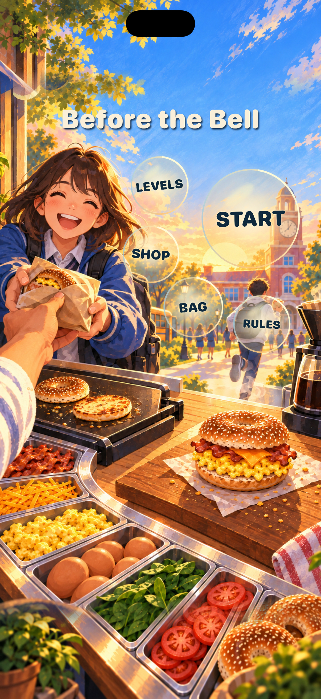
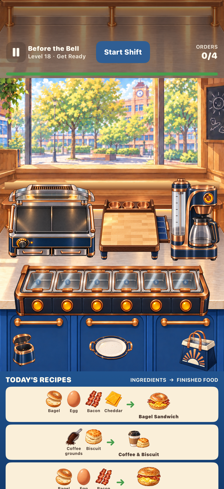
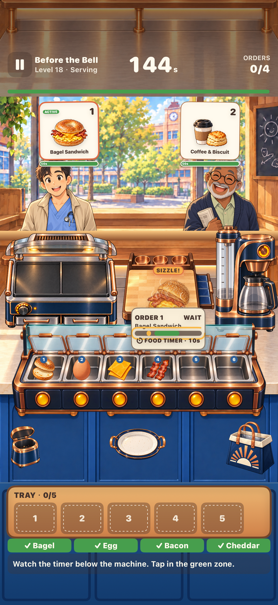
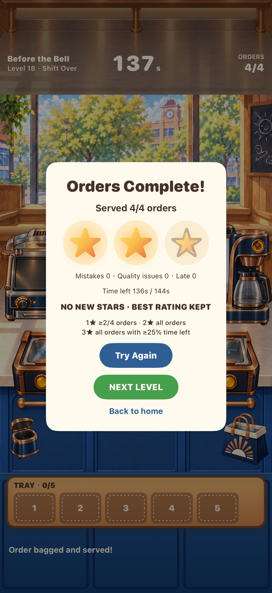
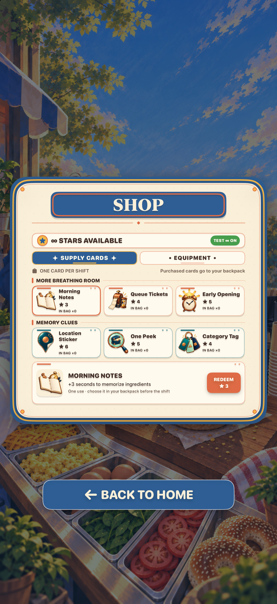

# Before the Bell｜铃响之前

一款以校园早餐店为舞台的限时制作与记忆游戏。开店前记住原料盒的位置；营业后按订单备料、操作设备，在顾客失去耐心前完成交餐。

本仓库是项目作品集，展示已实现的玩法、界面与技术设计。正式产品源码、完整关卡数据和原始美术素材不在公开范围内。

## 游戏画面

| 封面 | 开店前记忆 | 营业制作 |
| --- | --- | --- |
|  |  |  |

| 结算 | 商店 |
| --- | --- |
|  |  |

以上均为本项目 iPhone 版本的实际界面截图。截图中的插画来自项目原创生成与编辑素材，具体来源见 [素材说明](docs/素材说明.md)。

## 玩法与内容

- 50 个关卡分为五章，从单杯黑咖啡逐步推进到多订单、多设备排程及原料位置变化。
- 每局先预览原料位置，再从隐藏的原料盒取料，按配方完成贝果、松饼、咖啡等订单。
- 煎台、组装台与滴滤咖啡机分别有操作时机；成品品质和顾客等待时间影响结算。
- 通关获得的游戏金币可购买一次性补给与设备升级；进度、库存和最佳星级保存在本机，不涉及内购。
- 支持 iPhone、iPad 和 macOS 的不同窗口尺寸。

## 实现要点

- **规则与界面分离：** 纯 Swift 规则模块负责订单、设备、原料、结算和关卡进度；SwiftUI 负责场景呈现与操作反馈。
- **统一场景坐标：** 营业场景在 `1024 × 1536` 设计画布上定义物体位置，按设备尺寸换算显示区域与触控坐标。
- **分层美术：** 背景、顾客、设备、原料槽、餐品和订单票独立组合，让设备状态与顾客变化由游戏状态驱动。
- **本地持久化：** 金币、道具、装备选择和关卡星级通过本地存储恢复。

更多细节见 [玩法与工程说明](docs/玩法与工程说明.md)。

## 公开范围与素材使用

本作品集只包含项目介绍、工程说明和界面截图。截图及其中的视觉内容仅用于展示本项目；仓库没有附带可复用授权。若需使用相关素材或代码，请先取得权利人许可。未引入来源不明的第三方图片、字体、图标、音频或视频。
